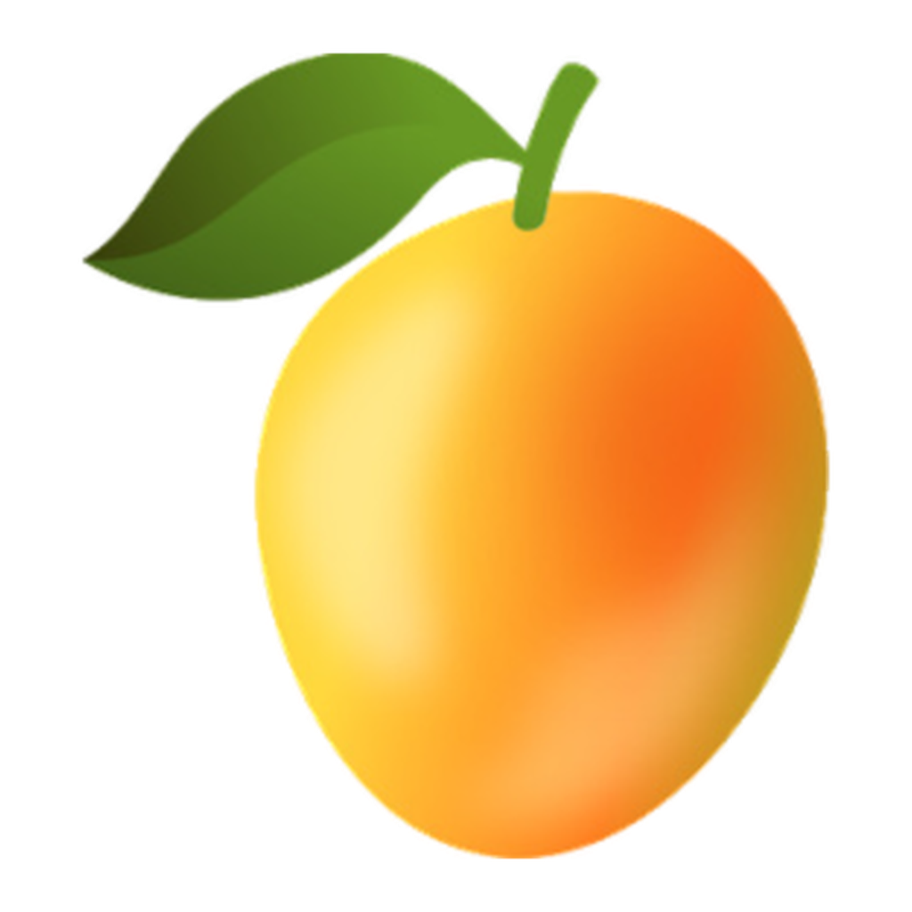

# MangabaClaw 🥭 — Seu assistente, nos seus dispositivos, nos seus chats

<p align="center">
  
</p>

<p align="center">
  <a href="LICENSE"></a>
  
  
</p>

**MangabaClaw** é um assistente de IA pessoal que roda nos seus próprios dispositivos e conversa com você nos canais que você já usa (WhatsApp, Telegram, Discord, webchat e mais). Ele conecta modelos, ferramentas, canais de mensagem e apps companheiros através de um único Gateway — projetado para um único operador, com seus dados sob seu controle.

É o fork brasileiro e rebrandizado do [OpenClaw](https://github.com/openclaw/openclaw), mantido pela **Mangaba AI** com identidade visual própria (paleta laranja `#E94A12`/creme, mascote mangaba 🥭) e interface **em português do Brasil por padrão**.

## Destaques

- 🥭 **100% em pt-BR** — interface traduzida (5.553 strings) e agente instruído a responder em português
- 🔌 **Multi-provedor** — DeepSeek, gateway agregador Mangaba (Gemini, Llama, MiniMax) e mais de 40 provedores via plugins (OpenAI, Anthropic, Groq, Ollama, ...)
- 💬 **Multicanal** — WhatsApp, Telegram, Discord, Slack, iMessage, e-mail e webchat
- 🖥️ **Control UI** — painel web completo (sessões, tarefas cron, plugins, aprovações)
- 🏠 **Local-first** — roda na sua máquina; credenciais ficam em `~/.mangabaclaw/`, nunca no repositório

## Instalação (a partir do código)

Requisitos: Node.js 22.22.3+ (26 recomendado) e [pnpm](https://pnpm.io).

```bash
git clone https://github.com/dheiver2/mangabaclaw.git
cd mangabaclaw
pnpm install
pnpm build
```

## Começo rápido

Configure um provedor e crie o workspace do agente (exemplo com DeepSeek):

```bash
pnpm mangabaclaw onboard --non-interactive --accept-risk \
  --auth-choice deepseek-api-key --deepseek-api-key SUA_CHAVE \
  --skip-channels --skip-daemon --skip-health --skip-hooks \
  --skip-search --skip-skills --skip-ui
```

Instale o Gateway como serviço (reinicia sozinho e sobe no login):

```bash
pnpm mangabaclaw gateway install
pnpm mangabaclaw gateway status
```

Converse pelo terminal:

```bash
pnpm mangabaclaw agent --message "Olá! O que você pode fazer?"
```

Ou abra a **Control UI** no navegador (o token está em `gateway.auth.token` no `~/.mangabaclaw/mangabaclaw.json`):

```
http://127.0.0.1:18790/?token=SEU_TOKEN
```

> Dica: se a porta 18789/18790 já estiver em uso por outro serviço, mude com
> `pnpm mangabaclaw config set gateway.port <porta>`.

## Provedores de modelo

Os provedores são plugins; cada um entra no seletor de modelos da UI depois de conectar a credencial:

```bash
pnpm mangabaclaw onboard --openai-api-key ...     # OpenAI
pnpm mangabaclaw onboard --deepseek-api-key ...   # DeepSeek
# Ollama local é detectado automaticamente quando está rodando
```

Também é possível apontar para qualquer endpoint compatível com OpenAI (como o gateway agregador da Mangaba) pela seção `models.providers` do `~/.mangabaclaw/mangabaclaw.json`.

## Comandos úteis

| Comando                            | O que faz                                      |
| ---------------------------------- | ---------------------------------------------- |
| `pnpm mangabaclaw gateway restart` | Reinicia o serviço do Gateway                  |
| `pnpm mangabaclaw models list`     | Lista os modelos configurados                  |
| `pnpm mangabaclaw tui`             | Interface de terminal (leve)                   |
| `pnpm mangabaclaw doctor`          | Diagnostica e repara a configuração            |
| `pnpm ui:build`                    | Reconstrói a Control UI após mudanças em `ui/` |

## Estrutura do projeto

- `src/` — núcleo do Gateway, agentes e CLI (TypeScript ESM)
- `ui/` — Control UI (Lit + Vite)
- `extensions/` — plugins de canais, provedores e ferramentas
- `apps/` — apps companheiros (macOS, iOS, Android, Linux)
- `docs/` — documentação

## Créditos e licença

Fork do [OpenClaw](https://github.com/openclaw/openclaw) (MIT). O aviso de licença original está preservado em [LICENSE](LICENSE) e as atribuições de terceiros em [THIRD_PARTY_NOTICES.md](THIRD_PARTY_NOTICES.md).

Rebranding e manutenção: **Mangaba AI** · [Dheiver Santos](https://dheiverphd.com)

Licença: [MIT](LICENSE)
